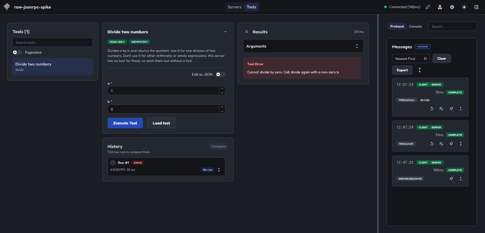

# MCP on the wire, without an SDK

I'm building a hub that sits between AI clients and production systems. Before I let a library hide the Model Context Protocol from me, I wanted to see it with nothing in the way. So I wrote an MCP server by hand: about 290 lines of TypeScript, no SDK. Then I rebuilt the same server on the official SDK and pointed one test client at both.

Everything here is about spec revision **2026-07-28**, and every message below is real output from my hand-written server (`spikes/raw-jsonrpc`).

## One request's life on stdio

The simplest MCP setup is stdio. The client (Claude, Cursor, MCP Inspector) starts your server as a child process and talks to it through stdin and stdout. Each message is **one JSON-RPC object on one line**. That's the whole transport.

It also means stdout is sacred. One stray `console.log` lands in the middle of the protocol stream and the client can't parse it. Every log line in my server goes to stderr.

The first thing a client does is ask the server who it is:

```json
→ {"jsonrpc":"2.0","id":1,"method":"server/discover","params":{"_meta":{"io.modelcontextprotocol/protocolVersion":"2026-07-28","io.modelcontextprotocol/clientCapabilities":{}}}}
← {"jsonrpc":"2.0","id":1,"result":{"supportedVersions":["2026-07-28"],"capabilities":{"tools":{}},"instructions":"…","ttlMs":3600000,"cacheScope":"private","resultType":"complete","_meta":{"io.modelcontextprotocol/serverInfo":{"name":"raw-jsonrpc-spike","version":"0.0.1"}}}}
```

## `server/discover` replaced `initialize`

Most MCP tutorials still start with an `initialize` handshake: the client introduces itself once, and the server remembers it for the rest of the session. That's the 2025 protocol. In 2026-07-28 the handshake is gone.

My server rejects `initialize` on purpose and tells the client what to use instead:

```json
← {"jsonrpc":"2.0","id":5,"error":{"code":-32601,"message":"Method 'initialize' was removed. This server supports protocol versions: 2026-07-28 (use server/discover).","data":{"supported":["2026-07-28"]}}}
```

`server/discover` is just a normal request. It returns the versions and capabilities the server supports, plus how long the client may cache that answer (`ttlMs` and `cacheScope`).

## Why any replica can serve any request

If there's no handshake, how does the server know which protocol version a client speaks? The client tells it **on every request**, in `params._meta`. My server checks that on every call:

- a required field is missing: `-32602`
- the version isn't supported: `-32022`, with the list of versions it does support

This was the part that clicked for me. The server remembers nothing between requests, so two requests from the same client can land on two different machines and both get the right answer. For the hub, that means no sticky sessions and no session store. Two replicas behind a plain round-robin load balancer just work.

## Tool errors vs protocol errors

My server has one tool, `divide`. It's deliberately boring, because its three possible outcomes teach the most useful distinction in MCP:

```json
← {"id":2,"result":{"content":[{"type":"text","text":"{\"quotient\":2}"}],"structuredContent":{"quotient":2},"isError":false, …}}
← {"id":3,"result":{"content":[{"type":"text","text":"Cannot divide by zero. Call divide again with a non-zero b."}],"isError":true, …}}
← {"id":4,"error":{"code":-32602,"message":"Unknown tool: nope"}}
```

- **Success** returns `structuredContent` matching the tool's `outputSchema`, plus the same data as text for clients that ignore structure.
- **A tool error** (`isError: true`) is still a _result_. The model reads the message and can fix its call. That's why the text is written as an instruction ("call divide again with a non-zero b"), not as an error code. Divide by zero, overflow, wrong argument types and extra argument keys all land here.
- **A protocol error** (`error`) means the request itself was wrong: an unknown tool, a broken envelope, an unsupported version. The client gets an exception, not something the model can learn from.

You can see the difference in MCP Inspector. When I called `divide` with `b = 0`, the result panel showed a red "Tool Error", but the protocol log marked the `tools/call` request as `COMPLETE`. The protocol worked fine; the tool just had bad news.

## Things that surprised me

- **The schema you advertise is a promise.** My hand-written tool said `additionalProperties: false`, but it quietly accepted `{"a": 6, "b": 3, "c": 1}`. The SDK version didn't even advertise the rule. A review caught it, and the contract test now checks that all three servers both advertise and enforce it. The model trusts your schema, so validate on the server.
- **Valid inputs can still produce invalid output.** `1e308 / 1e-308` is `Infinity`, and `JSON.stringify(Infinity)` is `null`. Without a check, the tool would have reported `{"quotient": null}` as a success.
- **Inspector speaks the old protocol by default.** Inspector 2.16.0 sends `initialize` unless you pass `--protocol-era modern`, and it needs Node 22.23.4 or newer. My server rejected it until I worked that out.
- **So does the SDK client.** Pin it: `versionNegotiation: { mode: { pin: "2026-07-28" } }`.
- **SDK v2 has two stdio entry points.** `serveStdio(factory)` speaks 2026-07-28. The familiar `server.connect(new StdioServerTransport())` only speaks the old protocol.
- **Every result needs `resultType: "complete"`.** When I removed it from my server, 7 of the 8 contract tests against it failed (only the unknown-tool error still passed), while the SDK servers kept passing. One missing field and a real client stops trusting you.
- **List results carry cache hints** (`ttlMs`, `cacheScope`), and `ping` is gone.

## Proof

- MCP Inspector (`--protocol-era modern`) lists and calls `divide` on the hand-written server. Dividing by zero comes back as a tool error, while the `tools/call` request itself completes:

  

- One SDK client, pinned to 2026-07-28, passes the same 8 contract checks against the hand-written server, the SDK stdio server and the SDK HTTP server.

## What's next

Writing it by hand once was worth it. When the SDK now validates `_meta` or turns bad arguments into a tool error, I know exactly what it's doing for me. In Phase 3 the hub gets its real `/mcp` endpoint, and with it the parts a toy server doesn't need: authentication on every request, tenant isolation, and provider tokens that never reach the model.

Code: `spikes/raw-jsonrpc` (by hand) and `spikes/sdk-server` (SDK v2).
